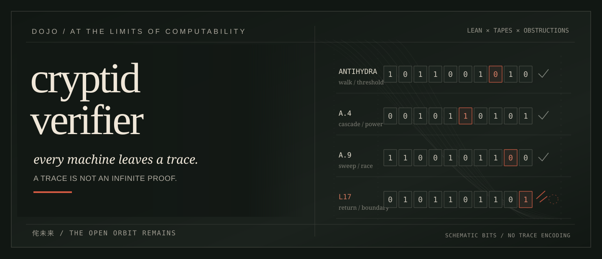
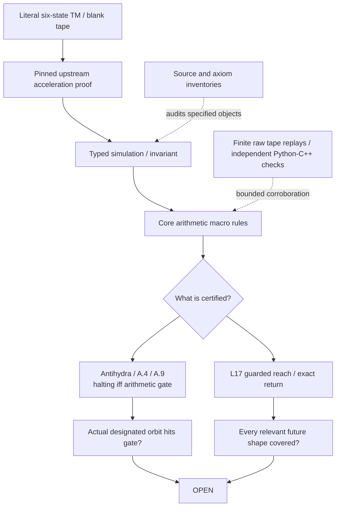

<div align="center">



<sub>侘未来 · WABI-FUTURISM / COMPUTABILITY × FORMAL VERIFICATION × OPEN ORBITS</sub>

# cryptid / verifier

### every machine leaves a trace.

*not every trace closes an orbit.*

**The machine is exact. The frontier is not negotiable.**

<sub>未完の軌道 · the unfinished orbit</sub>

</div>

---

## 00 / The creatures behind the tape

What happens when a tiny Turing machine grows a numerical universe too large to simulate—and we still refuse to mistake its behavior for a proof?

**cryptid-verifier** is a Lean 4 and finite-experiment research companion to [*At the Limits of Computability: Steps Towards Autonomous AI Discovery on the Busy Beaver Frontier*](https://arxiv.org/abs/2610.22603) (Dos Santos and collaborators, 2026).

The project connects **literal blank-tape machines** to proven arithmetic transition systems, then asks which properties of their actual orbits remain unsettled. Its machine-level links use the authors' pinned [google-deepmind/cryptids](https://github.com/google-deepmind/cryptids/tree/a0c1f56af53a76e985a656032b48015f7e48921b) formalization. The repository adds its own reductions, formal results and bounded independent transcriptions.

This is **not** a proof that any of the studied Cryptids runs forever. It is a disciplined map of what has been reduced to arithmetic, what has been checked about tapes and clocks, and what genuinely remains open.

> **A certified route to an astronomical configuration is still a finite route.**

The detailed, original [technical README](docs/README_MAIN_SNAPSHOT_2026-11-18.md) is preserved verbatim, including the comprehensive theorem inventory, guards, corrections and historical experiment links.

## 01 / Three machines, three exact questions

The three primary cases have **machine-level equivalences in Lean**, under the pinned definitions and imported upstream acceleration proofs. Their actual halting outcomes are not established here.

| Cryptid | Designated macro start | Lean-checked equivalence | Open question |
| :-- | :-- | :-- | :-- |
| **Antihydra** | `A(0,4)` | Raw machine halts exactly when the parity-driven `+2/−1` counter walk drops below zero | Does that particular deterministic orbit ever cross the barrier? |
| **A.4** | `C(0,3)` | Raw machine halts exactly when a reachable `C(m,1)` satisfies a precise power-of-two equation | Does its blank-start macro orbit ever meet that condition? |
| **A.9** | `C(5,2,0)` | Raw machine halts exactly when a reachable `C(a,b,c)` has `b ≥ 1` and `b = c` or `b = c+1` | Does the section's draining race ever reach that window? |

The A.4 arithmetic gate is especially small:

```math
m+s+4=2^{s+2}.
```
**Small does not mean solved.** The equivalence to a machine halt is proved; whether the designated orbit reaches such an `m` is still open.

The machine-link definitions are in [Antihydra](link/CryptidLink/Antihydra.lean), [A.4](link/CryptidLink/A4.lean), and [A.9](link/CryptidLink/A9.lean). Their core arithmetic systems live in [`AntihydraOuroboros/`](AntihydraOuroboros/Basic.lean).

For Antihydra, the separate [Mathlib bridge](mathlib/CryptidReal/Antihydra.lean) establishes a real-number representation of its trajectory:

```math
b_n=\left\lfloor \xi(3/2)^n\right\rfloor-3.
```
Here `ξ` is the particular explicit constant defined by the formal orbit construction, **not an arbitrarily chosen random real**. The floor identity does not supply the distribution theorem or effective tail estimate that would be required to settle non-halting.

## 02 / The fourth tape: L17

**L17 is an Appendix C lead**, not one of the paper's eleven principal Cryptids. Its development is a study in how much *exact reachability* can be established without a global halting answer.

One machine-checked orbit theorem reaches a macro state with a counter approximately **2.04 × 10²⁹⁵**, across **1,251 formal macro steps**. That number is not a simulated raw-step budget and is not evidence of an infinite run.

The later formal programme proves guarded return paths, restricted internal-graph termination, unique ancestry within that graph, and literal head/tape transport. The raw transition is **not injective**; no integer affine ranking function of the specified per-mode counter form decreases on every internal D/G row. This rules out **that ranking family**, not all possible termination arguments.

### The most recent merged mixed-boundary work

| Source on `main` | Actual theorem scope | What it does not establish |
| :-- | :-- | :-- |
| [`L17ae.lean`](link/CryptidLink/L17ae.lean), [PR #32](https://github.com/Dojo-1/cryptid-verifier/pull/32) | For fixed mixed token word `01·101·01·101·00`, all `p=u+4` and `c≥0` with symbolic outside tapes, an exact C return in `2u+4c+134` raw transitions, retaining the entire **unnormalized** output | Arbitrary mixed-token returns or blank-orbit occurrence |
| [`L17MixedBoundary.lean`](link/CryptidLink/L17MixedBoundary.lean), [PR #33](https://github.com/Dojo-1/cryptid-verifier/pull/33) | For guarded `a≥5,c≥1`, the saved mixed C-boundary returns in `4a+6c+152` raw steps, with complete tape context | Universal four-run/mixed-stack collapse |
| [`L17k.lean`](link/CryptidLink/L17k.lean) | Restricted acyclicity, unique roots, non-injective raw witness and the stated no-affine-rank obstruction | Global termination or any theorem about the entire infinite orbit |

**Still draft:** [PR #35](https://github.com/Dojo-1/cryptid-verifier/pull/35) proposes a full-tape *canonical-word identity* and composes it with the merged mixed-width return. Its proof was previously checked on another branch, but **the replacement PR remains unmerged** and must satisfy its own exact-head verification. Do not silently identify the merged unnormalized word with the proposed canonical form.

**Still open:** general mixed/five-run return, whether the designated blank orbit reaches the uncovered cases, a uniform stack-depth bound, and L17 halting/non-halting.

Read the [L17 research ledger](analysis/leads/L17.md), [mixed-boundary proof record](analysis/l17-mixed-proof/README.md), and [complete original theorem catalogue](docs/README_MAIN_SNAPSHOT_2026-11-18.md).

## 03 / Follow a claim all the way to the machine


The two kinds of evidence cannot be exchanged. A machine-level theorem carries its formal hypotheses; a literal simulator catches implementation mistakes **over a tested range**; and an asymptotic conjecture requires arguments beyond either a finite prefix or a model-generated story.

The checks deliberately distinguish full physical tape and head orientation from a compressed counter or a convenient substring. **Dropping an interior zero can change the theorem.**

## 04 / The laboratory has three clocks

This repository is not one monolithic Lake project. Three separately pinned formal environments make different commitments:

| Project | Lean toolchain | Responsibility |
| :-- | :-- | :-- |
| **core** `.` | **4.24.0**, no Mathlib | Arithmetic macro systems and bounded formal lemmas |
| **real-number** `mathlib/` | **4.24.0**, pinned Mathlib | Exact real/3⁄2 bridge |
| **machine links** `link/` | **4.35.0-rc4**, pinned upstream Cryptids | Raw Turing machines, simulations, contextual L17 returns |

To build and audit the intended chain, install [elan](https://github.com/leanprover/elan) and Python 3.10+, then run:

```sh
python3 scripts/verify.py
```
On Windows, the same driver supports:

```powershell
py -3 scripts/verify.py
```
Or select a bounded proof project:

```sh
python3 scripts/verify.py --project core
python3 scripts/verify.py --project mathlib
python3 scripts/verify.py --project link
```
The runner prepares generated L17 orbit proof sources, restores the pinned upstream data layout, builds, and audits. The exact [tooling contract](scripts/README.md) and [CI workflow](.github/workflows/lake-build.yml) explain caches, numerical dependencies, C++17 comparator requirements and platform coverage.

## 05 / A trust gate that knows its limits

The verification discipline combines **different** checks:

- Lean kernel checking of the actual theorem statements and their imports in each pinned project.
- An explicit [`#print axioms` inventory](scripts/trust_inventory.json) with build-log coverage, admitting only the stated standard axiom names in its inventoried output.
- A lexical source gate rejecting prohibited local declarations and proof escapes such as `sorry`, `admit` and `native_decide` in the monitored source.
- Hash-checked generated orbit proof files, literal-machine checks, mutation tests and independently implemented finite comparators.

A lexical gate is **not** protection against arbitrary hostile metaprogramming. A trusted Lean theorem about a given formalization is **not** an independent verification that every explanatory sentence is accurate. Imported acceleration lemmas must be understood according to their own source and assumptions.

**This README redesign did not rerun the three Lean builds or the numerical suites.** Any assertion that a particular new head is fully verified requires the exact GitHub Actions or local build receipt.

## 06 / What might actually settle a beast?

The attractive but unproved [logarithm-law conjecture](analysis/conjecture-logarithm-law.md) concerns **the designated blank-tape trajectories**, not every counter configuration. In fact, some other initial states halt. Finite numerical alignment with a logarithmic excursion model is not a proof of mixing, independence or non-halting.

The meaningful next theorems are more constrained:

1. An L17 return-or-exception theorem for an explicitly stated class of mixed stacks, with a typed and **reachable-or-not** residual.
2. A proof that a blank-start orbit avoids every halting gate—or a valid halting witness—using **its exact arithmetic dynamics**, not an analogy to random sequences.
3. Effective bounds with explicit onset and a checked prefix, sufficient to exclude the terminal region rather than merely predicting average behavior.
4. A simpler, independently reconstructable link from a raw machine to the criterion, preserving tapes, guards and clock semantics.

The project adopts a non-scalar evidence ledger: **P** for a Lean-checked statement with defined scope, **M** for finite measurement, **A** for assumed hypothesis, **H** for conjecture, **S** for semantic model and **R** for retired or refuted claims. Evidence belongs to an exact theorem or run, never to a name like *Cryptid* or *intelligence*.

## 07 / Provenance, not a costume

The underlying machine formalization and acceleration results belong to the authors of [google-deepmind/cryptids](https://github.com/google-deepmind/cryptids/tree/a0c1f56af53a76e985a656032b48015f7e48921b) and the accompanying [paper](https://arxiv.org/abs/2610.22603). This repository is an independently developed companion, not an official DeepMind release.

Research direction and additional reductions: Jesús Vilela Jato, with documented AI assistance for candidate derivations, code, and adversarial testing. Such assistance is **not** independent peer review.

The project is under [Apache-2.0](LICENSE); see [CITATION.cff](CITATION.cff) and [NOTICE](NOTICE) for citation and attribution. The original [README research archive](docs/README_MAIN_SNAPSHOT_2026-11-18.md) preserves the full theorem-by-theorem technical narrative.

The original artwork above uses *illustrative* binary tapes, not literal machine trace bytes, exact heads or a proof that any orbit is infinite.

---

<div align="center">

### 間 — ma

*A finite trace may be immense. Infinity still asks for a proof.*

**the machine is exact. the frontier is not negotiable.**

<sub>CRYPTID / VERIFIER · MACHINE, MACRO, INVARIANT, REMAINDER</sub>

</div>
